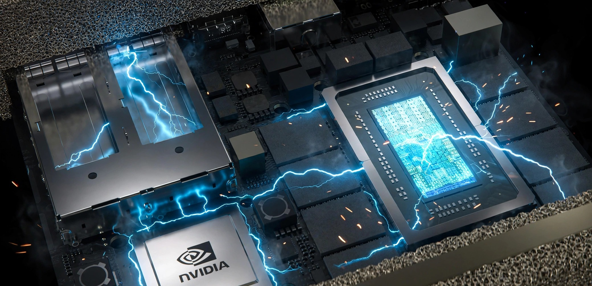

# gb10-ops



> **The GB10 setup standard**: for any GB10 device, any node count.
> Measured on real hardware; written so a human, or an AI agent,
> can apply and verify it.

> **Applying it? Start at [AGENT-APPLY.md](AGENT-APPLY.md).** That is the
> mechanical runbook for any node count from 1 to 8: one command per step,
> the output that means it worked, and the condition that means stop.

## The standard

| Area | Standard | Where |
|---|---|---|
| GPU clock cap | **2200 MHz**, persisted by `gb10-clock-cap.service` | `deploy/apply-2200.sh` |
| CPU clock cap | **2808 MHz** (X925 capped to the A725 ceiling), persisted by `gb10-cpu-cap.service` | `deploy/apply-2808.sh`, `docs/CPU-TUNING.md` |
| Kernel | **Qualified `7.0.0-1019-nvidia-64k`** (64 KiB pages) on DGX OS 7.6, explicit GRUB pin; `6.17.0-1032-nvidia` kept installed as the known-good rollback | `docs/HARDENING.md` |
| Boot default | **Explicit `7.0.0-1019-nvidia-64k` GRUB entry**, never `GRUB_DEFAULT=saved`; no reboot required | `deploy/apply-grub-default.sh`, `docs/HARDENING.md` |
| Headless | `multi-user.target`, display stack off | `docs/DGX-OS-7.6-HEADLESS.md` |
| Headless memory | `vm.watermark_boost_factor=0`; no `splash` on the command line; largest free block (`/proc/buddyinfo`) is a routine check | `docs/MEMORY-RECLAIM.md` |
| Hardening | CVE sysctls + nftables LSRR/SSRR drop | `docs/HARDENING.md` |
| Fabric (2+ nodes) | 200G ConnectX-7, twin IPs, MTU 9000, RDMA verified | `docs/QUAD-STACK.md` |
| Node user | `gb10` (uid 1000) in the examples; use your own name consistently | this file |

**Optional, gated component (not the standard):** the GB10 display
carveout can be lent to CUDA as ~2 GiB more KV cache or weights
(`bertholomus/spark-attic`, Apache-2.0 OR MIT — credits in
`docs/DISPLAY-CARVEOUT.md`). It is a per-node, driver-gated daemon;
`deploy/carveout-gate.sh <node>` decides whether a node may lend, and
`deploy/apply.sh` installs it as stage 2 on a node the gate calls
ELIGIBLE. **Installed and running on the four reference nodes since
2026-11-16** (state `ready`, `validated true`, `lent_mib 0`, unit
enabled+active), and nothing consumes the carveout yet: consumption is
stage 3 in `docs/APPLY-PLAN-2026-11.md`, gated on serving-recipe work.
Read `docs/DISPLAY-CARVEOUT.md` for the measured numbers and the conflict
with the UEFI reclaim step below. A node that never installs it follows
the standard exactly.

**Kernel baseline (updated Nov 2026):** the standard kernel is
`7.0.0-1019-nvidia-64k` on DGX OS 7.6, the qualified baseline for the
current serving profile (64 KiB pages, `kho=off` as shipped by DGX OS
packaging). `6.17.0-1032-nvidia` stays installed on every node as the
known-good rollback. `7.0.0-1024` remains forbidden (idle resets /
bootloops, no qualification). Earlier warnings about the stock
`7.0.0-1019` 4 KiB kernel (NCCL/RoCE ENOMEM reports) are historical:
the qualified path is the -64k variant, deployed and verified as a
uniform set; never mix kernels across a cluster. Also never install
`doca-ofed` or the dkms MFT package (breaks the ConnectX-7). Details
in `docs/HARDENING.md`.

## Status of every item in this standard (2026-11-16)

A standard is a claim about machines, so every row names what was read
back, not what was intended. "Reference fleet" is the maintainer's four
GB10 nodes (mixed models, one kernel); the readbacks are the 2026-11-16
captures kept with that fleet work. Nothing here assumes a node count:
your fleet may be one node or eight.

| Item | State | Verification, and its limit |
|---|---|---|
| GPU cap 2200 MHz | applied, all four | `gb10-clock-cap.service` enabled+active; `nvidia-smi --query-gpu=clocks.sm,clocks.max.sm` reads 2184–2190 MHz against a 3003 MHz max. The lock is not readable without root and no load test was run, so this is consistent-with, not proof-of |
| CPU cap 2808 MHz | applied, all four | `gb10-cpu-cap.service` enabled+active; `scaling_max_freq` = `cpuinfo_max_freq` = 2808000, governor `performance`, every policy |
| Kernel `7.0.0-1019-nvidia-64k` | applied, uniform | `uname -r` reads the qualified kernel; `getconf PAGESIZE` = 65536 on all four |
| Explicit boot default | applied | the unconditional default in the generated `grub.cfg` is the explicit 64k-kernel entry (read 2026-11-16); `deploy/apply-grub-default.sh --check` reports drift per node |
| Headless | applied | `systemctl get-default` = `multi-user.target`; display managers inactive; `modeset` = N |
| `vm.watermark_boost_factor=0` | applied, all four | drop-in `/etc/sysctl.d/90-watermark-boost.conf` present, `sysctl --system` rc=0, live value reads back 0. **Its benefit is unmeasured**: `MemAvailable` moved −96/+104/−11/+78 MiB across the four, i.e. noise. What the knob removes is high-order reclaim slack, which nobody has measured on these nodes |
| `splash` off the command line | staged, not live | removed from the vendor grub drop-in and the regenerated `grub.cfg` on all four (`splash` occurrences: 0); the live `/proc/cmdline` still carries it until the next planned reboot, because this standard does not reboot nodes |
| Hardening (CVE sysctls, nftables) | procedure, not re-verified 2026-11-16 | commands and expected output are in `docs/HARDENING.md`; the 2026-11-16 captures did not re-read them, so this row is a procedure to run, not a verified state |
| Fabric (2+ nodes) | procedure, per site | `docs/QUAD-STACK.md`; addresses are site data, shown only as documentation-range examples |
| Carveout daemon (stage 2) | applied, all four | `attic.service` enabled+active, NRestarts=0; `state ready`, `validated true`, `size_mib 2044`, `lent_mib 0`, 2816 KB RSS, 0.1–0.3 % CPU; the serving container was not restarted |
| Engine consumption (stage 3) | **not applied, gated** | zero tokens of the planned capacity are in use. It needs recipe work, a scratch engine and a comparison run: `docs/APPLY-PLAN-2026-11.md` §4 |

Fan control is not a row because there is no fan step: no fan tool is
installed, documented or required by this standard (see Thermals).

### Why 2200 MHz GPU?

GB10 units can hard power-off at ~88W GPU draw, a power-delivery defect
NVIDIA acknowledged in July 2026 (see `docs/POWER-DELIVERY.md`). The cap
keeps power well clear of it:

| Cap | Prefill | Power (inference) | Margin to 88W defect |
|---|---|---|---|
| 2000 | 2,880 tok/s | 21W | 48W |
| 2100 | 2,905 tok/s | 24W | 43W |
| **2200** | **3,009 tok/s** | **27W** | **38W** |

Measured Oct 16, 2026. Decode is memory-bound (~73 tok/s), flat across
caps; higher caps showed no meaningful gain, so 2200 is the standard.

### Why 2808 MHz CPU?

A/B v2 against a live serving stack (44 paired ABBA runs): ≤0.24%
serving cost, within noise, and ~15°C cooler on all-core CPU load.
Evidence: `docs/CPU-TUNING.md`.

## First-boot checklist (per node)

1. Create user `gb10` (uid 1000) or your equivalent; confirm SSH in.
2. **PD-controller firmware check:** `fwupdmgr get-devices`: the USB-C
   PD controller appears as an entry named **UEFI Device Firmware**
   (no "PD" in the name; when two such entries are listed, it is the
   second one). It must read `0x00000519`, not the factory stub
   `0x00000001` (a silent fwupd failure can leave it there; re-running
   `fwupdmgr update` fixed one unit). Verify the version actually
   changed. Some GB10 devices expose no such entry to fwupd at all;
   then there is nothing to check.
3. Install the qualified kernel set and confirm `uname -r` reads
   `7.0.0-1019-nvidia-64k` with `getconf PAGESIZE` = 65536; apply the
   GRUB pin in `docs/HARDENING.md`. Keep `6.17.0-1032-nvidia`
   installed as the rollback.
4. Apply both clock caps (below) and verify under load.
5. Go headless, apply hardening (`docs/HARDENING.md`), and set
   `vm.watermark_boost_factor=0` (`docs/MEMORY-RECLAIM.md`).
6. Optional, console only: UEFI *Display Reserved Memory* → Auto
   reclaims ~1.5 GB on headless nodes, and *After Power Loss → Auto
   Boot* enables real remote recovery (see Power / recovery). Pick this
   **or** carveout lending, not both — Auto shrinks the region that
   lending needs (`docs/DISPLAY-CARVEOUT.md`).
7. Clustering? Continue with `docs/QUAD-STACK.md`.

## Deployment

```bash
bash deploy/apply-2200.sh gb10@node1 gb10@node2   # GPU cap (SSH user@host); no args = auto-discover
bash deploy/apply-2808.sh node1 node2         # CPU cap (Tailscale node names, reached as root)
bash deploy/apply-grub-default.sh --check node1 node2   # boot-default drift report (read-only)
bash deploy/apply-grub-default.sh node1 node2           # explicit 7.0.0-1019-nvidia-64k GRUB default; no reboot
bash deploy/apply-2200.sh --uninstall gb10@node1  # remove GPU cap
bash deploy/carveout-gate.sh node1 node2         # read-only: may this node lend its display carveout?
# carveout stages, idempotent, 1 to 8 nodes; see AGENT-APPLY.md
bash deploy/apply.sh --inventory inventory.txt --check-inventory   # validate the node list
bash deploy/apply.sh --inventory inventory.txt --dry-run           # read-only plan
bash deploy/apply.sh --inventory inventory.txt --apply             # stage 1, then stage 2
bash deploy/apply.sh --inventory inventory.txt --verify            # re-read every check
bash deploy/apply.sh --inventory inventory.txt --rollback          # reverse stage 2, then stage 1
```

Example hostnames/IPs are examples. Substitute your own. The scripts
set the cap immediately, install the persistence service, and verify
per host. Run them via `bash` as shown: the executable bit is not
guaranteed on every download route. Note: `clocks.max` can still read 3003 under a lock on GB10;
verify under load (BF16 GEMM pins SM at ~2190 MHz).

## Power / recovery

- **Never test uncapped** without physical access. Hard power-off needs
  AC unplugged 30–60s; a reboot does not fix it.
- **Wake-on-LAN does not reliably wake GB10 nodes**: the EC cuts NIC
  standby power in S5. Real remote recovery = UEFI *After Power Loss →
  Auto Boot* + a switched PDU / smart plug.
- Apply caps on **every** node in a multi-node setup; mismatched caps
  cause issues. Abort stress tests if power >75W or SoC >92°C.

## Benchmarking

Use `llama-benchy` (not curl loops, not wall-clock division):

```bash
uvx llama-benchy \
  --base-url http://<node>:<port>/v1 \
  --model <model> --served-model-name <model> \
  --pp 2048 --tg 128 --exact-tg --runs 3 --latency-mode generation
```

Metrics: `tg` tok/s (decode, flat across caps), `pp` tok/s (prefill,
scales with clock), `e2e_ttft` to first **content** token. See
`tests/proper-sweep.sh` for a cap sweep. Stress-test power delivery:

```bash
git clone --depth 1 https://github.com/hoesing/spark-gpu-throttle-check
python3 spark-gpu-throttle-check.py -n 60   # on the node
```

**PASS:** clocks stay above 1400 MHz, power below 75W with cap in place.

## Serving note: Hugging Face cache on NFS

`huggingface_hub` 1.27 stores its token inside `~/.cache/huggingface`
and hardens that directory to mode 700, which breaks NFS-exported
cache reads under `root_squash`. Keep credentials out of NFS-exported
trees and keep the exported cache directory traversable (755).

## Thermals

Stock EC thermal behavior with the 2200 MHz cap is the standard
story. There is no fan-control step in this standard, optional or
otherwise: no fan tool is installed, documented, or required on a
node that follows it. Temperature is watched, not managed: abort a
benchmark if any node approaches 79 °C (the power-delivery defect
threshold, see `docs/POWER-DELIVERY.md`).

## Display driver modeset: off, via the OEM override package

The OEM package `nvidia-drm-options-modeset0` installs
`/etc/modprobe.d/zz-nvidia-drm-override.conf` with
`options nvidia-drm modeset=0`. The `zz-` name sorts last, so it wins
over the stock `nvidia-graphics-drivers-kms.conf` (`modeset=1`); the
effective state is `/sys/module/nvidia_drm/parameters/modeset` = `N`
on a headless node. This is the standing standard: **keep the
package, do not purge it** — purging it without a replacement config
lets the stock `modeset=1` take effect again. Serving profiles with
`carveout=0` (e.g. tp4-switched, which inherits carveout=0) need no
modeset purge at all; a purge is only a consideration for carveout
profiles (TP3-class), which this standard does not run.

## Serving profile notes: memory saver (site state)

The current serving profile was qualified with a UVM leaf-packing
memory saver active (`uvm_pack_sysmem_leaf_tables=Y`). DGX OS 7.6
ships no OEM saver: the stock driver has no such parameter, so the
only implementation is the recipe's own DKMS module
(`dgx-spark-memory-saver`), signed with a locally generated MOK key
and enrolled at a console reboot. Sites record their own state; on
any cluster the state must be UNIFORM across nodes — a kernel/page/
saver mismatch between nodes is an error state, while a uniform
warning-level deviation is a documented site choice.

## Repository structure

```
gb10-ops/
├── README.md                  # This file: the standard
├── AGENT-APPLY.md             # The runbook: apply it, 1 to 8 nodes, step by step
├── LICENSE                    # MIT
├── DESCRIPTION-CHANGE.md      # GitHub repo description (final text)
├── assets/
│   └── gb10-headline.jpg      # README banner image
├── deploy/
│   ├── apply-2200.sh          # GPU cap → gb10-clock-cap.service
│   ├── apply-2808.sh          # CPU cap → gb10-cpu-cap.service
│   ├── apply-grub-default.sh  # explicit GRUB boot default, never "saved"
│   ├── carveout-gate.sh       # read-only: may this node lend its display carveout?
│   └── apply.sh               # gate → stage 1 → stage 2, idempotent, with rollback
├── docs/
│   ├── CPU-TUNING.md          # CPU cap evidence (A/B v2 + burn test)
│   ├── POWER-DELIVERY.md      # Defect research and methodology
│   ├── HARDENING.md           # Kernel baseline + CVE mitigations
│   ├── DGX-OS-7.6-HEADLESS.md # Headless standard + DGX OS 7.6 kernel baseline
│   ├── MEMORY-RECLAIM.md      # Headless memory + fragmentation checks (Nov 2026)
│   ├── DISPLAY-CARVEOUT.md    # Optional carveout lending: analysis, gates, status, credits
│   ├── APPLY-PLAN-2026-11.md  # Staged plan + what is applied today, stage by stage
│   ├── ENGINE-CONSUMPTION-DESIGN.md  # Stage 3 feasibility, protocol, go/no-go
│   ├── QUAD-STACK.md          # N-node 200G fabric (any node count)
│   └── DEEPSEEK-PLANNING.md   # Serving-recipe notes (not the standard)
└── tests/
    ├── proper-sweep.sh        # llama-benchy clock-cap sweep
    ├── carveout-gate-selftest.sh  # fixture tests for deploy/carveout-gate.sh
    ├── apply-selftest.sh      # dry-run/idempotency/rollback tests for deploy/apply.sh
    ├── purity-scan.sh         # no site data, no personal data: tree scan
    └── fixtures/              # fake node roots + command doubles for the self-tests
```

## Attribution

Every upstream this repository borrows from, with its source and license:

- **agjs/gb10-clock-cap** — https://github.com/agjs/gb10-clock-cap — MIT.
  Benchmark rigor, soak testing methodology, the systemd cap unit.
- **MiaAI-Lab/sparkLimiter** — https://github.com/MiaAI-Lab/sparkLimiter —
  MIT. Multi-host deployment pattern for the clock cap.
- **hoesing/spark-gpu-throttle-check** —
  https://github.com/hoesing/spark-gpu-throttle-check — MIT.
  Power-delivery diagnostic.
- **eugr/llama-benchy** — https://github.com/eugr/llama-benchy — MIT.
  The benchmarking tool this repo's sweeps call.
- **bertholomus/spark-attic** — https://github.com/bertholomus/spark-attic —
  Apache-2.0 OR MIT (`LICENSE-APACHE`, `LICENSE-MIT`). The optional carveout
  lending daemon; gated by this repo, installed only as stage 2 on an
  ELIGIBLE node.
- **Christopher Owen (christopherowen)** — X article, "If you're running
  headless anyway, recover the memory and reduce the memory fragmentation",
  2026-11-16. Source of the headless-memory findings in
  `docs/MEMORY-RECLAIM.md`; quoted with attribution, no code taken.

## License

MIT
