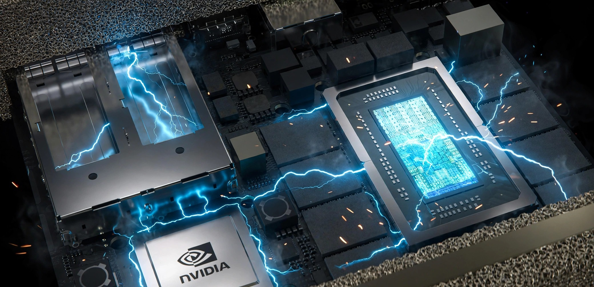

# gb10-ops



> **The GB10 setup standard**: for any GB10 device, any node count.
> Measured on real hardware; written so a human, or an AI agent,
> can apply and verify it.

## The standard

| Area | Standard | Where |
|---|---|---|
| GPU clock cap | **2200 MHz**, persisted by `gb10-clock-cap.service` | `deploy/apply-2200.sh` |
| CPU clock cap | **2808 MHz** (X925 capped to the A725 ceiling), persisted by `gb10-cpu-cap.service` | `deploy/apply-2808.sh`, `docs/CPU-TUNING.md` |
| Kernel | **Pinned `6.17.0-1032-nvidia`** with apt-mark holds; don't update to the latest kernel yet | `docs/HARDENING.md` |
| Boot default | **Explicit `6.17.0-1032` GRUB entry**, never `GRUB_DEFAULT=saved`; no reboot required | `deploy/apply-grub-default.sh`, `docs/HARDENING.md` |
| Headless | `multi-user.target`, display stack off | `docs/DGX-OS-7.6-HEADLESS.md` |
| Hardening | CVE sysctls + nftables LSRR/SSRR drop | `docs/HARDENING.md` |
| Fabric (2+ nodes) | 200G ConnectX-7, twin IPs, MTU 9000, RDMA verified | `docs/QUAD-STACK.md` |
| Node user | `gb10` (uid 1000) in the examples; use your own name consistently | this file |

**Don't update to the latest kernel yet:** the standard stays pinned
to `6.17.0-1032-nvidia` because the newest kernels are known-bad:
DGX OS 7.6's `7.0.0-1019` (NCCL/RoCE ENOMEM regression, GPU work
1.5–2.4x slower) and `7.0.0-1024` (idle resets / bootloops). Also
never install `doca-ofed` or the dkms MFT package (breaks the
ConnectX-7). Details in `docs/HARDENING.md`.

### Why 2200 MHz GPU?

GB10 units can hard power-off at ~88W GPU draw, a power-delivery defect
NVIDIA acknowledged in July 2026 (see `docs/POWER-DELIVERY.md`). The cap
keeps power well clear of it:

| Cap | Prefill | Power (inference) | Margin to 88W defect |
|---|---|---|---|
| 2000 | 2,880 tok/s | 21W | 48W |
| 2100 | 2,905 tok/s | 24W | 43W |
| **2200** | **3,009 tok/s** | **27W** | **38W** |

Measured Oct 16, 2026. Decode is memory-bound (~73 tok/s), flat across
caps; higher caps showed no meaningful gain, so 2200 is the standard.

### Why 2808 MHz CPU?

A/B v2 against a live serving stack (44 paired ABBA runs): ≤0.24%
serving cost, within noise, and ~15°C cooler on all-core CPU load.
Evidence: `docs/CPU-TUNING.md`.

## First-boot checklist (per node)

1. Create user `gb10` (uid 1000) or your equivalent; confirm SSH in.
2. **PD-controller firmware check:** `fwupdmgr get-devices`: the USB-C
   PD controller appears as an entry named **UEFI Device Firmware**
   (no "PD" in the name; when two such entries are listed, it is the
   second one). It must read `0x00000519`, not the factory stub
   `0x00000001` (a silent fwupd failure can leave it there; re-running
   `fwupdmgr update` fixed one unit). Verify the version actually
   changed. Some GB10 devices expose no such entry to fwupd at all;
   then there is nothing to check.
3. Confirm kernel is `6.17.0-1032-nvidia` (`uname -r`); apply the pin
   and holds in `docs/HARDENING.md`.
4. Apply both clock caps (below) and verify under load.
5. Go headless and apply hardening (`docs/HARDENING.md`).
6. Optional, console only: UEFI *Display Reserved Memory* → Auto
   reclaims ~1.5 GB on headless nodes, and *After Power Loss → Auto
   Boot* enables real remote recovery (see Power / recovery).
7. Clustering? Continue with `docs/QUAD-STACK.md`.

## Deployment

```bash
bash deploy/apply-2200.sh gb10@node1 gb10@node2   # GPU cap (SSH user@host); no args = auto-discover
bash deploy/apply-2808.sh node1 node2         # CPU cap (Tailscale node names, reached as root)
bash deploy/apply-grub-default.sh --check node1 node2   # boot-default drift report (read-only)
bash deploy/apply-grub-default.sh node1 node2           # explicit 6.17.0-1032 GRUB default; no reboot
bash deploy/apply-2200.sh --uninstall gb10@node1  # remove GPU cap
```

Example hostnames/IPs are examples. Substitute your own. The scripts
set the cap immediately, install the persistence service, and verify
per host. Run them via `bash` as shown: the executable bit is not
guaranteed on every download route. Note: `clocks.max` can still read 3003 under a lock on GB10;
verify under load (BF16 GEMM pins SM at ~2190 MHz).

## Power / recovery

- **Never test uncapped** without physical access. Hard power-off needs
  AC unplugged 30–60s; a reboot does not fix it.
- **Wake-on-LAN does not reliably wake GB10 nodes**: the EC cuts NIC
  standby power in S5. Real remote recovery = UEFI *After Power Loss →
  Auto Boot* + a switched PDU / smart plug.
- Apply caps on **every** node in a multi-node setup; mismatched caps
  cause issues. Abort stress tests if power >75W or SoC >92°C.

## Benchmarking

Use `llama-benchy` (not curl loops, not wall-clock division):

```bash
uvx llama-benchy \
  --base-url http://<node>:<port>/v1 \
  --model <model> --served-model-name <model> \
  --pp 2048 --tg 128 --exact-tg --runs 3 --latency-mode generation
```

Metrics: `tg` tok/s (decode, flat across caps), `pp` tok/s (prefill,
scales with clock), `e2e_ttft` to first **content** token. See
`tests/proper-sweep.sh` for a cap sweep. Stress-test power delivery:

```bash
git clone --depth 1 https://github.com/hoesing/spark-gpu-throttle-check
python3 spark-gpu-throttle-check.py -n 60   # on the node
```

**PASS:** clocks stay above 1400 MHz, power below 75W with cap in place.

## Serving note: Hugging Face cache on NFS

`huggingface_hub` 1.27 stores its token inside `~/.cache/huggingface`
and hardens that directory to mode 700, which breaks NFS-exported
cache reads under `root_squash`. Keep credentials out of NFS-exported
trees and keep the exported cache directory traversable (755).

## Fan control (optional, not the standard)

Stock EC thermal behavior with the 2200 MHz cap is the standard story.
Fan tools are documented-optional only; none is a default step:

- Owen's `dgx-spark-fan-control` (used by `fan-control/precool.sh`):
  validated on EC 3.5.8, **untested on EC 3.13.7**.
- Secure Boot is enabled: any kernel-module fan tool needs a MOK key
  enrolled via a console reboot.
- WeilJimmer's thermald/`nvfancontrol` stack is reported unsupported on
  EC 3.13.7. mathieu-lacage's fan-override module can clamp fan state
  across reboots (risk); its protocol docs are the ecosystem reference.

## Repository structure

```
gb10-ops/
├── README.md                  # This file: the standard
├── LICENSE                    # MIT
├── DESCRIPTION-CHANGE.md      # GitHub repo description (final text)
├── assets/
│   └── gb10-headline.jpg      # README banner image
├── deploy/
│   ├── apply-2200.sh          # GPU cap → gb10-clock-cap.service
│   ├── apply-2808.sh          # CPU cap → gb10-cpu-cap.service
│   └── apply-grub-default.sh  # explicit GRUB boot default, never "saved"
├── docs/
│   ├── CPU-TUNING.md          # CPU cap evidence (A/B v2 + burn test)
│   ├── POWER-DELIVERY.md      # Defect research and methodology
│   ├── HARDENING.md           # Kernel pin + CVE mitigations
│   ├── DGX-OS-7.6-HEADLESS.md # Headless standard; why not to update the kernel yet
│   ├── QUAD-STACK.md          # N-node 200G fabric (any node count)
│   └── DEEPSEEK-PLANNING.md   # Serving-recipe notes (not the standard)
├── fan-control/
│   └── precool.sh             # Optional pre-cooling (Owen's tool)
└── tests/
    └── proper-sweep.sh        # llama-benchy clock-cap sweep
```

## Attribution

- **agjs/gb10-clock-cap**: Benchmark rigor, soak testing methodology
- **hoesing/spark-gpu-throttle-check**: Power-delivery diagnostic
- **christopherowen/dgx-spark-fan-control**: Pre-cooling concept
- **mathieu-lacage/dgx-spark-fan-override**: EC protocol docs
- **miaai-lab/sparkLimiter**: Deployment pattern
- **eugr/llama-benchy**: Benchmarking tool

## License

MIT
